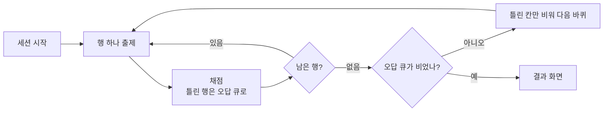

# 표 암기 드래그 퀴즈 앱 PRD

Oct 10, 2026 · @송예린

## 개요와 목표

표 사진을 칸 단위 이미지로 잘라서 대표 칸을 보고 나머지 열의 칸 카드를 끌어다 놓으며 표 전체를 다시 맞추는 iPad 웹앱이다. 칸은 기본적으로 그림으로 쓰고 쪼개기가 필요한 열만 기기 안에서 글자로 읽는다. 외부 API 없이 브라우저 안에서 모두 처리한다.

- **해결할 문제:** 근육의 기시·정지·신경지배·작용 같은 표는 행끼리 헷갈리는 지점이 핵심이다. 눈으로 읽기만 하면 이 구분이 잡히지 않는다.
- **핵심 흐름:** 표 사진 넣기 → 칸 격자 확정 → 대표 열과 출제 열 지정 → 퀴즈 → 틀린 행을 다 맞힐 때까지 반복
- **성공 기준:**
  - 20행 × 5열 표를 사진에서 퀴즈 가능한 상태로 만드는 데 3분 이내
  - iPad Safari에서 카드를 끌 때 지연이 느껴지지 않음
  - 비행기 모드에서도 저장된 표로 퀴즈 가능

## 사용 환경

iPad Safari에서 홈 화면 앱으로 실행하고 GitHub Pages로 배포한다. 로그인 없는 1인용 앱이다.

- **기기:** iPad 가로·세로 모두 지원. 손가락과 Apple Pencil 드래그 모두 지원
- **배포:** GitHub Pages 주소(예: `<계정>.github.io/table-quiz`)를 Safari에서 열고 "홈 화면에 추가"
- **전체 화면 실행:** `manifest.json`과 `apple-mobile-web-app-capable` 메타 태그로 주소창 없이 실행
- **오프라인:** service worker가 앱 파일을 캐시. 표 데이터는 기기 안 IndexedDB에 저장
- **개발 환경:** Mac 없이 iPad에서 Claude Code로 개발. 확인은 배포된 주소를 iPad Safari로 열어서 함

## 핵심 개념과 데이터 모델

정답 판정은 글자가 아니라 칸 id로 한다. 놓은 카드의 칸 id가 정답 칸이거나 정답 칸과 같은 그룹이면 정답이다. 글자 열은 칸을 쪼갠 조각 단위로 판정하고 글자가 같으면 같은 값으로 본다.

| 개념 | 정의 |
| --- | --- |
| 표 | 사진 1장에서 만든 퀴즈 단위 |
| 칸 | 격자 한 칸을 잘라낸 이미지. 행·열 좌표와 걸친 행 수(rowSpan)를 가짐 |
| 헤더 행 | 열 이름이 적힌 행. 카드로 쓰지 않고 슬롯 이름표로 씀 |
| 대표 열 | 퀴즈에서 제시되는 열. 기본은 첫 열이고 어느 열이든 고를 수 있음. 값이 겹치는 열을 고르면 같은 값 행을 한 문제로 합침 |
| 출제 열 | 카드를 끌어다 놓을 열. 기본은 대표 열을 뺀 전부 |
| 병합 칸 | 여러 행에 걸친 칸. 걸친 모든 행에서 정답 |
| 같은 값 그룹 | 다른 행에 있지만 내용이 같은 칸 묶음. 서로 바꿔 놓아도 정답. 글자 열은 글자가 같으면 자동으로 같은 값 |
| 제외 행 | 시험 범위 밖이라 퀴즈에서 뺀 행 |

IndexedDB 저장소(object store) 구성:

```js
// tables
{ id, name, createdAt, sourceImageId,
  grid: { xs: [x0, x1, ...], ys: [y0, y1, ...] }, // 세로선·가로선 위치 (원본 픽셀)
  hasHeader: true,
  repCol: 0,                 // 대표 열 (어느 열이든 가능)
  quizCols: [1, 2, 3],       // 출제 열
  colModes: { 3: 'text' },   // 열별 읽기 방식. 없으면 'image'
  colNames: { 1: '기시' },   // 헤더 행이 없을 때 쓰는 열 이름
  splitChars: [',', '+', '\n'], // 글자 열 쪼개기 기준. '/', ';', '·'는 선택
  excludedRows: [7, 8],
  sameGroups: [[cellIdA, cellIdB], ...], // 사진 열용 수동 묶음
  quizSettings: { mode, optionCount, trayLayout, order, recallGate } } // order: 'table' | 'random' | 'weak-first', recallGate: 'off' | 'tap' | 'delay3s'

// cells
{ id, tableId, row, col, rowSpan, imageId,
  text: 'C5, C6',            // 글자 열만. 사용자가 확인·수정한 값
  parts: ['C5', 'C6'],       // 쪼갠 조각. 카드 한 장씩
  ocrConf: 62,               // 인식 신뢰도(0~100). 낮으면 확인 목록 위로
  checked: true }            // 사용자가 확인·수정함

// images
{ id, blob }                 // 원본 사진과 칸 이미지

// sessions
{ tableId, round, queue: [itemKey...], filled: { itemKey: { col: [cardKey...] } }, results: [...], updatedAt }
// itemKey = 문제 단위. 보통 행 번호, 대표 열 값이 겹치면 묶인 행들의 키
// cardKey = 사진 열은 cellId, 글자 열은 정규화한 조각 글자

// rowStats
{ tableId, row, wrongCount, lastWrongAt } // 세션 간 누적. '약한 행 먼저' 정렬에 사용
```

## 기능 1 표 사진 가져오기

표의 선을 자동으로 찾아 격자를 만들고 틀린 곳만 손으로 고친 뒤 칸마다 잘라 저장한다. 선 감지는 canvas `getImageData`로 직접 구현하고 라이브러리는 쓰지 않는다.

1. **사진 선택:** `<input type="file" accept="image/*">`로 촬영 또는 사진 보관함에서 선택. 긴 변을 2000px로 줄여 저장. 선택 화면에 "강의 PDF는 스크린샷으로 넣으면 칸 인식이 잘 돼요" 안내 표시
2. **영역 자르기·회전:** 표 바깥 여백을 잘라내고 90° 단위 회전과 ±5° 미세 회전 제공
3. **격자 자동 감지:**
   1. 그레이스케일 → 이진화(어두운 픽셀 = 1)
   2. 행마다 어두운 픽셀 비율을 세서 폭의 60% 이상 이어지는 줄을 가로선 후보로, 열 방향도 같은 방식으로 세로선 후보로 잡음
   3. 3px 안에 붙은 후보는 하나로 합침
   4. 선을 거의 못 찾으면 "선을 찾지 못했어요" 안내 후 수동 모드로 전환
4. **수동 보정:** 핀치로 확대. 선을 끌어서 이동, 빈 곳 탭으로 선 추가, 선을 길게 눌러 삭제. 실행 취소 버튼 제공
5. **병합 칸 지정:**
   - 자동 제안: 열마다 칸 경계의 가로선 구간을 검사해서 선이 끊긴 곳을 병합 후보로 표시
   - 확정: 병합 모드에서 위아래로 이어진 칸을 끌어 선택하면 하나로 합침. 다시 탭하면 해제
6. **헤더 행 지정:** 첫 행이 열 이름이면 켬
7. **잘라 저장:** 칸마다 선 두께만큼 안쪽으로 잘라서 이미지 Blob으로 저장

완료 기준: 실제 해부학 교재·족보 표 사진 3장 모두 자동 감지 후 보정 5회 이내로 격자가 확정된다.

## 기능 2 표 설정

격자 확정 직후 한 화면에서 무엇을 묻고 무엇을 같은 답으로 칠지 정한다. 표 목록에서 언제든 다시 열 수 있다.

- **표 이름:** 텍스트 입력. 기본값은 저장 날짜
- **대표 열:** 열 머리를 탭해서 선택. 기본은 첫 열이고 어느 열이든 가능. 예를 들어 신경지배 열을 대표로 두면 신경 → 근육 방향으로 묻는 퀴즈가 됨
- **출제 열:** 열마다 켜기·끄기. 기본은 대표 열을 뺀 전부
- **열 이름:** 헤더 행이 있으면 그 칸 이미지를 이름표로 씀. 없으면 "열 2"처럼 기본 이름을 주고 텍스트로 바꿀 수 있음
- **행 제외:** 행마다 켜기·끄기. 시험 범위 밖 행을 뺄 때 사용
- **같은 값 묶기:**
  1. 사진 열 하나를 고르면 그 열의 칸 썸네일이 격자로 뜸. 글자 열은 자동으로 묶이므로 이 단계가 없음
  2. 같은 내용끼리 차례로 탭하고 "묶기"를 누르면 그룹 생성
  3. 그룹마다 색 점을 붙여 표시. 그룹 안 칸을 다시 탭하면 빠짐
- **표 관리:** 표 목록에서 복제·이름 바꾸기·삭제(확인 창 필수)

### 열별 읽기 방식

열마다 사진과 글자 중 하나를 고른다. 기본은 사진이고 신경 번호처럼 값을 쪼개야 하는 열만 글자로 바꾼다.

| 방식 | 카드 | 쪼개기 | 같은 값 묶기 |
| --- | --- | --- | --- |
| 사진 (기본) | 칸 이미지 한 장 | 안 함 | 수동 |
| 글자 | 조각마다 텍스트 카드 한 장 | 쉼표·더하기·줄바꿈 기준 자동 | 같은 글자끼리 자동 |

글자로 바꾸면 다음 순서로 진행한다.

1. **인식:** 그 열의 칸 이미지만 Tesseract.js로 읽음. 인식 언어는 한국어+영어(숫자 포함)
2. **확인:** 칸 이미지와 인식 글자를 나란히 보여주는 목록에서 틀린 글자를 고침. 인식 신뢰도가 낮은 칸은 노란 표시로 먼저 보이게 정렬
3. **쪼개기:** 쉼표(`,`)·더하기(`+`)·줄바꿈 기준으로 조각을 나눠 미리보기. `/`, `;`, `·`는 표 설정에서 켜고 끔. 칸 전체나 조각을 감싼 괄호(`()`, `[]`)는 지움. 예: `(추1,추2)` → `추1`·`추2`, `추1+추2` → `추1`·`추2`. 중간 괄호는 남김: `C5, C6 (C7)` → `C5`·`C6 (C7)`. 조각마다 앞뒤 공백을 지우고 대소문자를 맞춰 비교용 값으로 저장
4. **되돌리기:** 언제든 사진으로 되돌릴 수 있고 고친 글자는 남겨둠

## 기능 3 퀴즈 세션

세션은 활성 행을 한 바퀴 돌고 틀린 행만 다시 묻기를 오답이 0개가 될 때까지 반복한다. 시작할 때 아래 설정을 고르고 표마다 마지막 선택을 기억한다.

| 설정 | 선택지 | 기본값 |
| --- | --- | --- |
| 모드 | 전체 슬롯 / 열 단계 | 전체 슬롯 |
| 먼저 떠올리기 | 끔 / 탭해서 열기 / 3초 뒤 열기 | 탭해서 열기 |
| 보기 개수 | 같은 열 전체 / 3\~8개 | 5개 |
| 트레이 배치 (전체 슬롯 모드) | 열별 줄 / 모두 섞기 | 열별 줄 |
| 행 순서 | 표 순서 / 무작위 / 약한 행 먼저 | 무작위 |

### 먼저 떠올리기

대표 칸이 뜬 직후에는 트레이를 가려서 보기 없이 답을 먼저 머릿속으로 꺼내게 한다. 보기에서 고르기만 하면 알아보는 힘(재인)만 늘고 빈칸을 직접 채우는 힘(회상)은 덜 늘기 때문이다.

- 가린 동안 트레이 자리에 "떠올렸으면 탭" 안내를 표시
- **탭해서 열기:** 트레이를 탭하면 카드가 나타남. **3초 뒤 열기:** 3초가 지나면 자동으로 나타남
- 전체 슬롯 모드는 문제마다 한 번, 열 단계 모드는 열마다 한 번 가림
- 틀린 칸만 다시 물을 때도 똑같이 가림

### 전체 슬롯 모드

- 위쪽에 대표 칸 이미지를 크게 보여주고 그 아래에 출제 열마다 빈 슬롯을 열 이름표와 함께 놓음
- 아래 트레이에 출제 열별 보기 카드를 깔아둠. "열별 줄"은 열마다 가로 한 줄, "모두 섞기"는 전부 섞어서 한 판에 배치
- 슬롯이 다 차면 "확인" 버튼 활성화. 누르면 슬롯마다 맞음·틀림을 표시하고 틀린 슬롯 옆에 정답 카드를 보여줌

### 열 단계 모드

- 대표 칸과 현재 열 슬롯 하나만 보여주고 트레이에는 그 열 카드만 깔림
- 카드를 놓는 즉시 판정. 맞히면 다음 출제 열로, 틀리면 정답을 1초 보여준 뒤 다음 열로 넘어감
- 한 행의 출제 열을 모두 마치면 다음 행

### 보기 카드 만들기

- **정답 카드:** 그 행·열의 칸. 병합 칸이면 걸친 행 모두에서 같은 카드가 정답
- **글자 열:** 조각 하나가 텍스트 카드 한 장. 슬롯 수는 그 칸의 조각 수이고 순서는 상관없음. 'C5, C6'이면 슬롯 두 개에 C5·C6을 모두 놓아야 정답
- **오답 카드:** 같은 열에서 무작위로 뽑음. 사진 열은 정답과 같은 값 그룹인 칸과 병합으로 같은 칸을 뺌. 글자 열은 같은 열의 다른 조각에서 뽑되 정답 조각과 같은 글자는 뺌
- **개수 부족:** 열에 서로 다른 값이 설정 개수보다 적으면 있는 만큼만 깖
- **대표 칸 제시:** 대표 열이 글자 열이어도 쪼개지 않고 칸 이미지 전체를 보여줌
- 카드 틀 고정: 카드 모양이 답의 힌트가 되지 않도록 한 열의 카드는 모두 같은 크기 틀에 넣음. 틀 크기는 그 열에서 가장 큰 칸 기준이고 최소 높이 56px. 칸 이미지는 잘라 저장할 때 글자 바깥 흰 여백을 다듬고 틀 안에 비율을 유지한 채 가운데 정렬. 텍스트 카드도 열마다 같은 너비에 글자 크기 17px 고정. 슬롯도 같은 틀 크기

### 값이 겹치는 대표 열

대표 열에 병합 칸이나 같은 값 그룹이 있으면 그 행들을 한 문제로 합친다. 예를 들어 근피신경(musculocutaneous n.)을 대표로 두면 위팔두갈래근(biceps brachii)·위팔근(brachialis)·부리위팔근(coracobrachialis) 행이 한 문제가 된다.

- 대표 칸은 묶음에서 한 장만 제시
- 출제 열마다 슬롯 수 = 묶인 행들에서 그 열의 서로 다른 값 개수. 같은 값 그룹과 병합 칸은 하나로 셈
- 슬롯 순서는 상관없고 전부 맞게 채워야 그 열이 정답
- 오답 큐와 누적 기록에는 행이 아니라 이 묶음 단위로 들어감

### 끌어다 놓기

- HTML5 drag-and-drop은 iPad 터치에서 불안정하므로 Pointer Events로 직접 구현
- 카드가 손가락을 따라오고 슬롯 위에 오면 슬롯 테두리 강조
- 탭 방식도 지원: 카드 탭 → 슬롯 탭
- 이미 찬 슬롯에 놓으면 기존 카드는 트레이로 돌아감. 슬롯의 카드를 끌어내면 비움
- 카드를 길게 누르면 확대 미리보기. 칸 이미지의 작은 글씨를 읽기 위함

### 반복과 종료

- 한 칸이라도 틀린 행은 오답 큐에 넣고 바퀴가 끝나면 큐만 섞어서 다시 물음
- **틀린 칸만 다시 묻기:** 전체 슬롯 모드는 맞힌 슬롯을 미리 채워 잠그고 틀린 슬롯만 비워둠. 열 단계 모드는 틀린 열만 출제
- 큐가 비면 결과 화면: 걸린 바퀴 수, 첫 바퀴 정답률, 자주 틀린 행 목록, 열별 오답 수
- **섞기 권유:** 트레이를 "열별 줄"로 풀었고 첫 바퀴 정답률이 90% 이상이면 결과 화면에 "다음엔 모두 섞기로" 버튼을 띄움. 열별 줄은 카드 위치만으로 범주가 드러나는 힌트가 되기 때문
- **누적 기록:** 세션이 끝날 때마다 행별 누적 오답 수를 갱신. "약한 행 먼저" 순서는 이 수가 큰 행부터 출제
- 중간에 나가도 진행 상태를 저장하고 다음에 "이어하기"로 재개



바퀴가 끝날 때마다 오답 큐를 확인하고 비어 있을 때만 결과 화면으로 간다.

## 화면 구성과 UI 원칙

화면은 6개이고 한 화면에 한 가지 일만 시킨다.

| 화면 | 하는 일 | 다음 화면 |
| --- | --- | --- |
| 홈 | 표 목록, 새 표 추가, 이어하기 | 가져오기 / 세션 설정 |
| 가져오기 | 사진 선택, 격자 감지·보정, 병합 지정 | 표 설정 |
| 표 설정 | 대표·출제 열, 읽기 방식, 행 제외, 같은 값 묶기 | 홈 / 세션 설정 |
| 세션 설정 | 모드, 보기 개수, 트레이 배치, 순서 | 퀴즈 |
| 퀴즈 | 대표 칸, 슬롯, 카드 트레이 | 결과 |
| 결과 | 바퀴 수, 정답률, 자주 틀린 행, 섞기 권유 | 홈 / 다시 하기 |

- **배치:** 가로 모드는 왼쪽에 대표 칸과 슬롯, 오른쪽에 트레이. 세로 모드는 위아래로 배치
- **터치:** 버튼과 카드 터치 영역 최소 44pt
- **피드백:** 맞음·틀림은 색과 아이콘(✓ ✗)을 함께 씀. 색만으로 구분하지 않음
- **다크 모드:** `prefers-color-scheme`를 따름. 칸 이미지는 원본 그대로 두고 카드 테두리로 구분
- **iPad Safari 대응:**
  - 퀴즈 영역에 `touch-action: none`을 걸어 드래그 중 스크롤·확대 방지
  - `-webkit-touch-callout: none`과 `user-select: none`으로 길게 누를 때 이미지 저장 메뉴와 텍스트 선택 방지
- **문구:** 모든 버튼과 안내는 한국어. 설명 문장 없이 동사형 버튼("확인", "다음", "묶기")

## 기술 스택, 저장, 배포

순수 HTML/CSS/JS에 빌드 도구 없이 ES 모듈을 그대로 쓴다. 외부 라이브러리는 글자 인식용 Tesseract.js와 한국어·영어 인식 데이터(kor·eng traineddata)만 쓴다. CDN에서 불러오지 않고 저장소 안에 넣어서 오프라인에서도 동작하게 한다.

```
table-quiz/
├── index.html
├── manifest.json
├── sw.js              # 오프라인 캐시, CACHE_VERSION 상수. vendor/도 캐시
├── css/style.css
├── icons/             # 180·192·512px 앱 아이콘
├── vendor/tesseract/  # tesseract.esm.min.js, worker, wasm core, lang/kor·eng traineddata
└── js/
    ├── app.js         # 화면 전환(해시 라우팅)
    ├── db.js          # IndexedDB 래퍼
    ├── grid-detect.js # 선 감지, 병합 후보
    ├── grid-editor.js # 격자 수동 보정 UI
    ├── cropper.js     # 칸 잘라내기
    ├── ocr.js         # 글자 열 인식, 확인 목록, 쪼개기·정규화
    ├── settings.js    # 표 설정 화면
    ├── dnd.js         # Pointer Events 드래그
    └── quiz.js        # 세션, 보기 생성, 채점, 반복
```

- **저장:** 이미지가 많아서 localStorage(약 5MB)로는 부족하므로 IndexedDB에 Blob으로 저장. localStorage는 마지막 세션 설정 같은 작은 값만
- **데이터 보존:** 첫 실행 때 `navigator.storage.persist()` 요청. 홈 화면 앱으로 실행해야 Safari의 자동 삭제 위험이 줄어듦
- **백업:** 설정 메뉴에 "전체 내보내기"(이미지를 base64로 담은 .json을 파일 앱에 저장)와 "가져오기" 제공
- **배포:** GitHub Pages 무료 사용은 공개(public) 저장소가 조건. `main` 브랜치 루트를 Pages로 지정
- **캐시 갱신:** 배포할 때마다 `sw.js`의 `CACHE_VERSION`을 올려서 iPad가 새 버전을 받게 함

글자 인식은 OCR 엔진을 처음 불러올 때 수 초가 걸린다(한국어 데이터 포함). 인식 파일은 처음 쓸 때 받아 캐시하고 이후엔 오프라인에서도 쓴다. 표 설정에서 글자 열을 처음 고를 때만 불러오고 퀴즈 중에는 쓰지 않는다.

## 개발 단계

4단계로 나눠 한 단계씩 Claude Code에 넘기고 단계마다 iPad에서 확인한 뒤 다음으로 간다. 이 문서를 Markdown으로 내보내 저장소에 `PRD.md`로 넣고 "PRD.md의 N단계만 구현해줘"라고 지시한다.

1. **뼈대·저장·배포**
   - 저장소 생성, 파일 구조, 해시 라우팅, `db.js`, `manifest.json`, `sw.js`, 앱 아이콘, GitHub Pages 설정
   - 다크 모드는 처음부터 CSS 변수로 깔아둠. 백업 내보내기·가져오기도 이 단계에서 만들어 이후 단계의 데이터 유실을 막음
   - 완료 기준: iPad 홈 화면에서 전체 화면으로 열리고 빈 표 목록과 백업 버튼이 보임
2. **표 가져오기**
   - 수동 격자 편집 → 자동 감지 → 병합 지정 → 칸 잘라 저장
   - 완료 기준: PDF 스크린샷 2장과 카메라 사진 1장의 칸 이미지가 저장되고 앱을 껐다 켜도 남아 있음
3. **표 설정**
   - 대표·출제 열, 열 이름, 행 제외, 같은 값 묶기, 열별 읽기 방식(글자 인식 → 확인 → 쪼개기)
   - 완료 기준: 설정을 바꾸고 다시 열었을 때 그대로 유지. 백업 후 복원해도 유지. 신경 번호 열의 'C5, C6' 칸이 카드 두 장으로 쪼개짐
4. **퀴즈와 기록**
   - 열 단계 모드 → 전체 슬롯 모드 → 보기·트레이 설정 → 먼저 떠올리기 → 카드 틀 고정 → 값이 겹치는 대표 열 → 틀린 칸만 다시 묻기 → 결과 화면과 섞기 권유 → 누적 기록과 약한 행 먼저 → 이어하기 → 터치 감각 다듬기
   - 완료 기준: 병합 칸과 같은 값 그룹이 있는 표에서 정답 판정이 모두 맞음. 신경지배 열을 대표로 둔 퀴즈가 묶음 단위로 출제됨

## 범위 밖과 추후 과제

1차 버전에서는 아래를 만들지 않는다.

- 사진 열의 값 쪼개기. 사진 열은 칸 하나 = 카드 한 장이고 쪼개야 하면 글자 열로 바꿈
- 사진 원근 보정(비스듬히 찍은 사진 펴기)
- 같은 값 자동 제안(칸 이미지 유사도 비교)
- 날짜 간격을 두는 본격 간격 반복(SRS). 1차는 누적 오답 수 기반 "약한 행 먼저"만 지원
- 기기 간 동기화

열린 질문: 선 없이 여백으로만 칸이 나뉜 표를 자주 쓰는지. 자주 쓴다면 2단계에서 여백 기준 감지를 추가한다.
